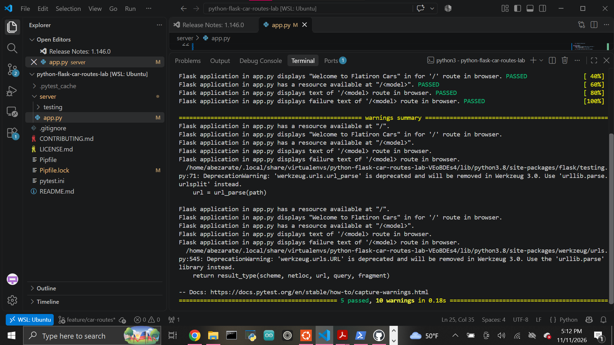

# Lab: Introduction to Flask - Car Routes

A small Flask application that demonstrates basic routing with a default route and a dynamic model route for a fictional car company.

## Features

The application includes two routes:

### Default Route

```text
/
```

Returns:

```text
Welcome to Flatiron Cars
```

### Model Route

```text
/<model>
```

The route checks the requested model against the following available models:

```python
["Beedle", "Crossroads", "M2", "Panique"]
```

If the requested model exists, the application returns:

```text
Flatiron {model} is in our fleet!
```

Example:

```text
Flatiron Crossroads is in our fleet!
```

If the model does not exist, the application returns:

```text
No models called {model} exists in our catalog
```

Example:

```text
No models called realCar exists in our catalog
```

## Project Structure

```text
python-flask-car-routes-lab/
├── images/
│   └── tests-passing.png
├── server/
│   ├── app.py
│   └── testing/
│       ├── app_test.py
│       └── conftest.py
├── Pipfile
├── Pipfile.lock
├── pytest.ini
└── README.md
```

## Setup

Install the project dependencies:

```bash
pipenv install
```

Enter the virtual environment:

```bash
pipenv shell
```

The project uses Python 3.8.13.

## Running the Flask Application

From the project root, run:

```bash
python server/app.py
```

The Flask development server runs on port `5555`.

Open the default route in a browser:

```text
http://127.0.0.1:5555/
```

You can also request a model:

```text
http://127.0.0.1:5555/Beedle
```

or:

```text
http://127.0.0.1:5555/Crossroads
```

## Testing

Run the test suite with:

```bash
python -m pytest -v
```

Current result:

```text
5 passed
```

The tests verify:

- the `/` route exists,
- the `/` route returns the expected welcome message,
- the `/<model>` route exists,
- available models return the expected fleet message,
- unavailable models return the expected catalog message.

## Completed Test Suite



## Technologies

- Python
- Flask
- pytest
- Pipenv
- Git and GitHub

## Author

Abraham Zarate